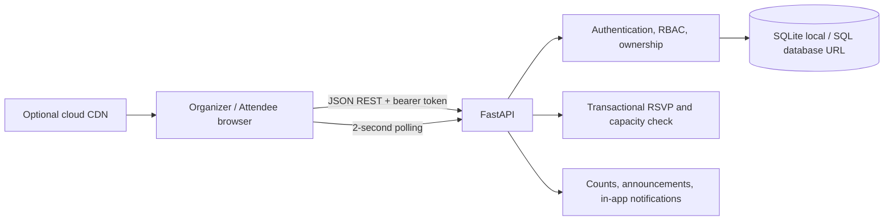

# Real-Time Cloud-Based Event Planning & RSVP Tracker

A virtual, student-friendly cloud-computing project for event publishing, invitations, attendee responses, capacity control, announcements, notifications and organizer analytics.

> **Truth in deployment:** the folder contains a runnable local application and container/CI templates. No cloud account, managed database, third-party authentication, WebSocket service, or live deployment has been provisioned. See [`cloud/README.md`](cloud/README.md) for the deployment plan.

## Problem and objectives

Event details, guest replies and announcements often live across messages and spreadsheets. This app centralizes the event record and attendee response behind an API so participants can use separate devices and the organizer can see updated counts. It demonstrates REST, authentication, role authorization, relational constraints, transaction safety, polling-based live updates, notifications and an upgrade path to managed cloud services.

## Features

- Attendee and organizer registration/login, PBKDF2 password hashes, expiring signed tokens and server-side logout revocation.
- Event create, read, update and soft-cancel; date/time, online meeting link, event type, deadline and capacity fields.
- Invitations recorded by email; registered invitees receive an in-app invitation notice.
- One RSVP per event/user; Going, Maybe and Not Going updates; attendee cancellation and organizer-only guest list.
- Transaction-protected local capacity checks, FIFO waitlist and automatic first-in-line promotion when a Going attendee cancels or changes response.
- Announcements and persistent in-app notifications with read state.
- Organizer metrics for invite response rate, capacity utilization, open seats, waitlist and response history.
- Browser polls the API every two seconds so other profiles see new counts without a manual page refresh.
- Docker image, health route, environment configuration, CI workflow and automated tests.

## Architecture



SQLite is the default local database. A managed PostgreSQL target is supported by SQLAlchemy's `DATABASE_URL` selection, but production concurrency locking and schema migrations must be adapted and tested before switching. Polling is the implemented realtime simulation. SSE, WebSockets, a managed realtime database, queues, external email/push delivery, cloud authentication and autoscaling are architecture extensions, not current implementations. Full mapping is in [`docs/ARCHITECTURE.md`](docs/ARCHITECTURE.md).

## Technology choices

| Option | Stack | Difficulty and cost | Tradeoffs |
|---|---|---|---|
| A: local simulation (implemented) | HTML/CSS/JS, FastAPI, SQLite, polling | Easy; free on your computer | Works offline; single-host database and polling only |
| B: student cloud (recommended target) | Static React or current browser app, FastAPI, managed auth, managed PostgreSQL/realtime | Medium; free quotas and terms vary | Demonstrates managed services; provider adapters and current limits need selection |
| C: advanced cloud | CDN, API gateway, serverless/container API, managed DB, WebSocket, queue, monitoring | Advanced; may incur charges | More scalable and operationally complex |

Cloud provider availability and free tiers change, so verify pricing, regional availability, retention and payment requirements before provisioning. Architecture alternatives are in the deployment guide.

## Roles and workflow

| Capability | Attendee | Organizer |
|---|---:|---:|
| Register/sign in, discover events, see announcements | Yes | Yes |
| Create/edit/cancel event, invite attendees | No | Own events |
| RSVP, update/cancel own RSVP, join waitlist | Yes | Yes |
| Guest roster and event analytics | No | Own events |
| Publish announcement | No | Own events |

Registration allows organizer self-selection for the synthetic local demonstration. Restrict organizer provisioning in any public deployment. Authentication answers who the user is; authorization checks role, ownership and record owner at each protected action.

## Real-time and capacity behavior

After an attendee submits a response, the backend validates deadline and capacity, writes within a transaction, and the organizer's browser picks up the authoritative aggregate on its next two-second poll. Polling is simple but repeats requests; SSE is a one-way server stream; WebSockets support two-way communication and fanout. A managed realtime subscription is another cloud option.

The naive sequence `if going_count < capacity: insert RSVP` can oversell because concurrent requests may both observe the last seat. SQLite uses `BEGIN IMMEDIATE` around the count/check/upsert, and `(event_id, user_id)` is unique. PostgreSQL should lock the event row or use an atomic reservation transaction; do not assume SQLite's file lock is a production multi-instance solution.

## Install and run locally

Python 3.11+ and pip:

```powershell
py -m venv .venv
.\.venv\Scripts\Activate.ps1
python -m pip install -r requirements.txt
Copy-Item .env.example .env
$env:APP_SECRET = "replace-with-a-long-random-secret"
python -m uvicorn backend.app:app --reload
```

Open `http://127.0.0.1:8000`; interactive API docs are `/docs`; health is `/health`. The database defaults to `events.db` in this folder. To run the synthetic walkthrough, use a separate browser profile per user: register Organizer; create “Cloud Computing Workshop” with a future registration deadline and capacity 100; register Attendee A and RSVP Going; register Attendee B and RSVP Maybe then Going; confirm live counts change; test announcement, RSVP cancellation, full capacity, waitlist and unauthorized event edits. Never use real personal data.

For a three-window view, open the same URL in organizer, attendee A and attendee B profiles. Browser local storage is profile-specific; server database state is shared.

## Configuration and deployment

`.env.example` documents `DATABASE_URL`, `APP_SECRET` and `CORS_ORIGINS`. Never commit `.env`. For a generic container run: `docker build -t event-rsvp .` then run port 8000 and pass a strong `APP_SECRET`; mount persistent storage for SQLite or configure a managed SQL database. A free/student cloud sequence and AWS/Azure/GCP reference are in [`cloud/README.md`](cloud/README.md). Cloud resources can incur cost; set alerts and teardown unused resources.

## API, data and errors

The API has endpoints for auth, events, invitations, RSVPs, waitlists, attendee's RSVPs, guest lists, analytics, announcements and notifications. Read [`docs/API_REFERENCE.md`](docs/API_REFERENCE.md) for request shape, access rules and status codes. Relational records include users, events, RSVPs, waitlist entries, invitations, announcements, notifications and revoked session tokens. Unique constraints cover user email, `(event_id,user_id)` RSVP, waitlist membership, invitations and token signatures. The backend is the source of truth; UI counts are never accepted from clients.

## Testing

```powershell
python -m pytest -q
python -m compileall -q backend tests\test_app.py
node --check frontend/app.js
```

Tests cover assets, auth/passwords, role checks, event ownership/edit/cancel, RSVP changes and capacity, deadlines, invitation/announcement notifications, waitlist promotion, token logout and analytics. See [`docs/TEST_PLAN.md`](docs/TEST_PLAN.md). Browser multi-user behavior and cloud restoration remain manual checks.

## Security, resilience and scale

Local controls include password hashing, HMAC-signed expiring sessions, server-side revocation, Pydantic validation, event ownership checks, notification ownership checks, parameterized SQLAlchemy queries and database uniqueness. Configure strict CORS, HTTPS, a secret manager, API rate limiting, backups, structured monitoring and least-privilege database accounts before public exposure. In-memory errors are returned through FastAPI; RSVP writes roll back on failure; polling retries on the next interval after transient network failure. External notification retry queues and idempotency keys are future work.

At higher volume, place stateless API replicas behind a gateway/load balancer, use managed database connections and indexes, cache public event detail, queue notifications, rate-limit RSVP bursts, and use a strongly consistent reservation transaction for hot events. Realtime fanout needs a shared broker rather than per-process memory. Details: [`docs/ARCHITECTURE.md`](docs/ARCHITECTURE.md).

## Project structure

```text
backend/                     FastAPI routes, SQLAlchemy models and local services
frontend/                    Browser HTML, CSS, JavaScript and polling refresh
tests/                       Automated route-logic tests
cloud/                       Container/cloud deployment notes
docs/                        Architecture, API, test and evidence guides
reports/                     Course report and placement materials
sample_data/                 Synthetic walkthrough data
screenshots/                 Genuine evidence screenshots (capture yourself)
.github/workflows/           Test CI
Dockerfile                   Container image
```

## Limitations and future improvements

The local app uses one SQLite database and polling, and organizer self-registration is demo-only. Cloud auth/realtime providers, actual email/SMS/push, invitations delivery, automatic reminders, multi-instance-safe PostgreSQL reservations, admin role, load/stress tests, browser automation, full migration tooling and a real deployment remain future work. No fake deployment result or screenshot is included.
