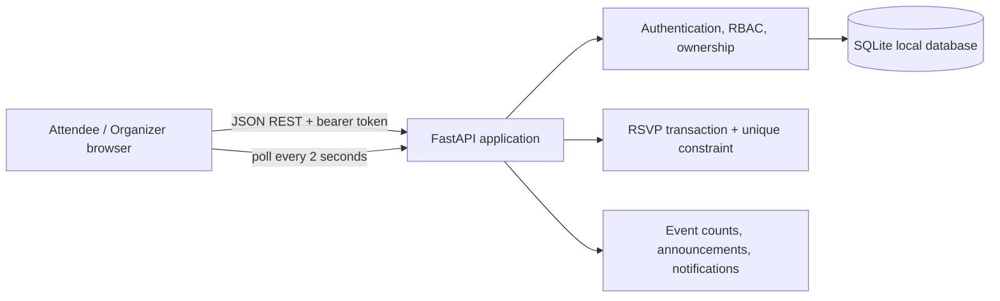
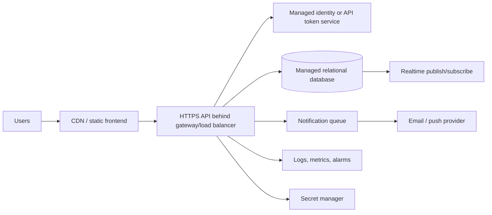

# Architecture and cloud concepts

## Implemented local path

The browser renders HTML/CSS/JavaScript. FastAPI validates and authorizes input; SQLAlchemy persists relational records. Polling refetches events and notices every two seconds. The API/database own RSVP truth; browser local storage only marks the viewer's last selected button.

## Cloud version target

The cloud target is a design, not provisioned infrastructure. The current app implements password authentication, DB-backed accounts and polling. It does not implement third-party cloud authentication, server-side WebSockets/SSE, notification providers, CDN, autoscaling or multi-zone failover.

## Concept-to-project map

| Concept | Project mapping |
|---|---|
| Cloud computing / SaaS | Users access one centrally hosted app in the deployment target; local run models the client/service boundary. |
| PaaS / IaaS | Managed container and database are PaaS; VM/network administration is an alternative IaaS deployment. |
| Cloud DB / realtime DB | SQLite is local; `DATABASE_URL` supports SQLAlchemy-compatible hosted relational database. Polling simulates live shared state; cloud realtime is future work. |
| REST / API gateway | FastAPI routes are REST resources; a gateway is an optional cloud ingress layer. |
| AuthN / AuthZ / RBAC | PBKDF2 password hashes, signed 24-hour tokens, token revocation, attendee/organizer role and resource ownership checks. |
| WebSockets / SSE | Architectural alternatives for server push; not implemented in this local HTTP polling version. |
| Serverless / event-driven / functions | A future approach for notification and reminder work; current app is a long-running API. |
| Scaling / elasticity / load balancing | Stateless replicas are a target; SQLite write lock means local single-instance use. Production needs row-level locking and load testing. |
| CDN / cache | CDN can serve frontend assets; no response cache is currently configured. |
| Env / secrets | `DATABASE_URL`, `APP_SECRET`; use host secret store in production. Never commit `.env`. |
| Logging / monitoring | Runtime logs and `/health` are basic; structured request metrics/alarms require host integration. |
| Backup / HA | Must be provided and restore-tested by selected managed DB/cloud host; local SQLite has no automated backups. |
| CI/CD | GitHub Actions workflow runs tests; deployment pipeline requires user-selected cloud credentials and is intentionally not configured. |

## Capacity race condition

With 1 seat remaining, two independent `count < capacity` reads can both succeed before either insert commits. The local implementation obtains SQLite's `BEGIN IMMEDIATE` write lock before reading the RSVP and count, checks capacity, then upserts and commits. `(event_id, user_id)` uniqueness also prevents duplicate records. On PostgreSQL use a transaction with `SELECT ... FOR UPDATE` on the event row (or an atomic conditional reservation update) and test concurrent requests. Do not use the SQLite locking code as a substitute for Postgres row locking.

## Scale evolution

- **100 users:** single API and relational DB; indexes, request validation and short polling are sufficient for a demo.
- **10,000 users:** managed DB, connection pooling, stateless API replicas, pagination, request limits, CDN and event update pub/sub.
- **1,000,000 users / flash crowd:** queue and rate-limit writes; partition/serialize hot event reservations; use a dedicated reservation primitive or strongly consistent database transaction; distribute realtime fanout; cache read-heavy event details; monitor DB hot rows and queue lag. Never cache seat decisions as authoritative.
